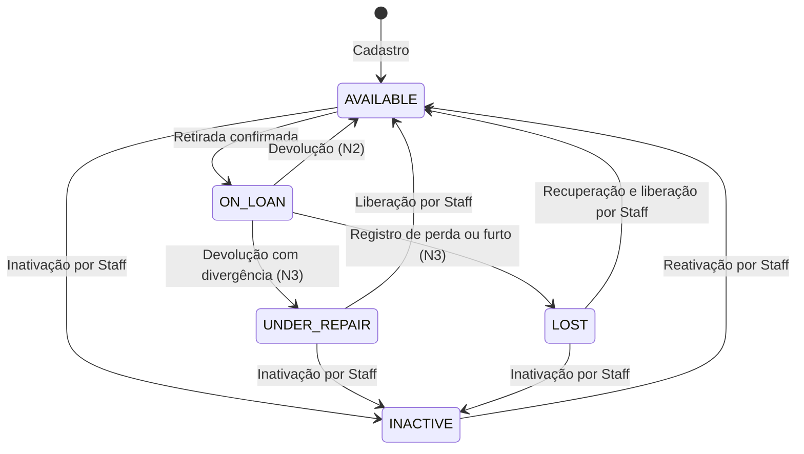

# Monitoolring

O **Monitoolring** organiza o empréstimo de ferramentas em um makerspace: identifica
quem retirou cada ferramenta, registra seu estado de conservação e acompanha o prazo
de devolução. Membros consultam o catálogo; o Staff confirma retiradas e devoluções.

A regra crítica do projeto é: **quem tem empréstimo em atraso não pode retirar outra
ferramenta até resolver todas as pendências**. O backend já implementa esse bloqueio e o fluxo
de devolução com checklist; veja o [status dos requisitos](#status-dos-requisitos).

Este é o monorepo [iagokoch/horangotango](https://github.com/iagokoch/horangotango), com
`backend/`, `frontend/` e documentação. O projeto acadêmico evolui em três entregas:

- **N1:** base da API, importada da branch `master` do backend original.
- **N2:** entrega individual de backend, com meta de **15 dos 19 requisitos funcionais**
  do PRD (aproximadamente 79%). O frontend e os artefatos de requisitos são de outros integrantes.
- **N3:** continuidade pela equipe, com os quatro FRs restantes e as evoluções documentadas.

## Sumário

- [Domínio e ciclo da ferramenta](#domínio-e-ciclo-da-ferramenta)
- [Estrutura do monorepo](#estrutura-do-monorepo)
- [Status dos requisitos](#status-dos-requisitos)
- [Backend](#backend)
  - [Stack](#stack)
  - [Pré-requisitos](#pré-requisitos)
  - [Como iniciar](#como-iniciar)
  - [Variáveis de ambiente](#variáveis-de-ambiente)
  - [Testes e comandos úteis](#testes-e-comandos-úteis)
  - [Autenticação e papéis](#autenticação-e-papéis)
  - [Endpoints implementados](#endpoints-implementados)
  - [Respostas de erro](#respostas-de-erro)
  - [Swagger e Postman](#swagger-e-postman)
  - [Estrutura de pacotes](#estrutura-de-pacotes)
- [Frontend](#frontend)
- [Documentação](#documentação)
- [Fluxo do repositório](#fluxo-do-repositório)
- [O que mudou desde a N1](#o-que-mudou-desde-a-n1)
- [Pendências para a N3](#pendências-para-a-n3)

## Domínio e ciclo da ferramenta

| Termo | Significado |
|---|---|
| Membro (`MEMBER`) | Pessoa cadastrada que consulta ferramentas e toma empréstimos |
| Staff (`STAFF`) | Responsável pela oficina; cadastra ferramentas e confirma as operações no balcão |
| Ferramenta | Bem cadastrado individualmente, com código, nome, categoria, valor estimado e estado de conservação |
| Disponível (`AVAILABLE`) | Ferramenta que pode ser retirada |
| Emprestada (`ON_LOAN`) | Ferramenta vinculada a um empréstimo ativo |
| Em reparo/inspeção (`UNDER_REPAIR`) | Ferramenta retirada de circulação após divergência na devolução; fluxo previsto para N3 |
| Perdida (`LOST`) | Ferramenta com perda ou furto registrado; fluxo previsto para N3 |
| Inativa (`INACTIVE`) | Ferramenta fora de circulação por decisão do Staff |
| Empréstimo | Vínculo entre ferramenta, membro e Staff, com data de retirada e prazo de devolução |
| Retirada | Confirmação pelo Staff que abre o empréstimo e marca a ferramenta como emprestada |
| Devolução | Confirmação pelo Staff que encerra o empréstimo e registra a conferência da ferramenta |
| Checklist de Conservação | Registro imutável do estado funcional, avarias visíveis e acessórios na retirada ou devolução |
| Prazo de Devolução | Data e hora limite calculadas a partir do prazo padrão vigente na retirada |
| Atraso | Empréstimo ainda não encerrado cuja data e hora limite já foram ultrapassadas |
| Bloqueio por Inadimplência | Impedimento de nova retirada enquanto houver pelo menos um empréstimo em atraso |
| Perda | Encerramento de empréstimo sem devolução física por perda, furto ou destruição da ferramenta (N3) |

O diagrama representa o **ciclo previsto**, incluindo funcionalidades ainda não implementadas.
Retirada, devolução e liberação do bloqueio estão implementadas; divergência e perda são N3.



Os cinco valores de `ToolStatus` já existem no backend. O `PATCH` permite atribuir apenas
`AVAILABLE` ou `INACTIVE` e rejeita a mudança de status de uma ferramenta `ON_LOAN` com
`409`. Os outros estados são definidos pelos fluxos de negócio. O empréstimo usa os valores
`ACTIVE`, `RETURNED` e `LOST`; o atraso é derivado em tempo real, sem coluna própria nem job.

## Estrutura do monorepo

```text
horangotango/
├── README.md                         # Visão geral, execução e andamento do projeto
├── backend/                          # API Java/Spring Boot e testes
│   ├── pom.xml
│   ├── mvnw / mvnw.cmd                # Maven Wrapper
│   ├── docker-compose.yml            # PostgreSQL local na porta 5433
│   ├── src/main/                     # Código, configuração e migrations
│   ├── src/test/                     # Testes unitários e de integração
│   └── docs/                         # PRD, contratos da API e guia de testes
│       ├── postman/                  # Coleção Postman
│       └── requisitos-n2/            # Artefatos de Engenharia de Requisitos
└── frontend/                         # Área de outro integrante; apenas clear.md no estado atual
```

## Status dos requisitos

A referência é o [PRD](backend/docs/prd.md). **✅ na `main`** indica código implementado;
**➡️ N3** indica escopo reservado para a continuidade. Uma issue aberta não significa, por si só, ausência de código.

| FR | Requisito | Status | Issue |
|---|---|---|---|
| FR-1 | Cadastro e login de Membro | ✅ na `main` | [#1](https://github.com/iagokoch/horangotango/issues/1) |
| FR-2 | Cadastro e login de Responsável da Oficina (Staff) | ✅ na `main` | [#1](https://github.com/iagokoch/horangotango/issues/1) |
| FR-3 | Cadastro de Ferramenta | ✅ na `main` | [#2](https://github.com/iagokoch/horangotango/issues/2) |
| FR-4 | Edição e inativação de Ferramenta | ✅ na `main` | [#2](https://github.com/iagokoch/horangotango/issues/2) |
| FR-5 | Consulta de disponibilidade | ✅ na `main` | [#2](https://github.com/iagokoch/horangotango/issues/2) |
| FR-6 | Consulta de histórico de Membro (Staff) | ➡️ N3 | [#13](https://github.com/iagokoch/horangotango/issues/13) |
| FR-7 | Consulta dos próprios Empréstimos (Membro) | ➡️ N3 | [#14](https://github.com/iagokoch/horangotango/issues/14) |
| FR-8 | Configuração do prazo padrão de devolução | ✅ na `main` | [#3](https://github.com/iagokoch/horangotango/issues/3) |
| FR-9 | Solicitação de Retirada | ✅ na `main` | [#4](https://github.com/iagokoch/horangotango/issues/4) |
| FR-10 | Checklist de Conservação na Retirada | ✅ na `main` | [#4](https://github.com/iagokoch/horangotango/issues/4) |
| FR-11 | Confirmação de Retirada e prazo de devolução | ✅ na `main` | [#4](https://github.com/iagokoch/horangotango/issues/4) |
| FR-12 | Bloqueio de Retirada por Inadimplência (RN Crítica) | ✅ na `main` | [#5](https://github.com/iagokoch/horangotango/issues/5) |
| FR-13 | Registro de Devolução | ✅ na `main` | [#6](https://github.com/iagokoch/horangotango/issues/6) |
| FR-14 | Checklist de Conservação na Devolução | ✅ na `main` | [#6](https://github.com/iagokoch/horangotango/issues/6) |
| FR-15 | Fluxo de decisão em divergência de Checklist | ➡️ N3 | [#15](https://github.com/iagokoch/horangotango/issues/15) |
| FR-16 | Atualização de disponibilidade pós-Devolução | ✅ na `main` | [#6](https://github.com/iagokoch/horangotango/issues/6) |
| FR-17 | Marcação automática de Atraso | ✅ na `main` | [#5](https://github.com/iagokoch/horangotango/issues/5) |
| FR-18 | Liberação automática de Bloqueio | ✅ na `main` | [#5](https://github.com/iagokoch/horangotango/issues/5) |
| FR-19 | Registro de Perda de Ferramenta | ➡️ N3 | [#16](https://github.com/iagokoch/horangotango/issues/16) |

Estado atual do backend: **15 FRs implementados na N2** e **4 reservados para N3**.
A release v2.0 é uma etapa separada; a implementação não significa que a release já foi publicada.

Backlog por entrega: [N2 — v2.0](https://github.com/iagokoch/horangotango/milestone/1) e
[N3](https://github.com/iagokoch/horangotango/milestone/2). A cobertura dos FRs acima se refere
ao backend; o frontend tem implementação separada.

## Backend

### Stack

- Java 21 e Spring Boot **3.3.2**: Web, Validation, Security e Actuator.
- PostgreSQL **16** no Compose, JPA/Hibernate e migrations com Liquibase.
- JWT stateless com jjwt **0.12.6**, papéis `MEMBER`/`STAFF` e senhas com BCrypt.
- MapStruct **1.6.3** para conversão entre entidades e DTOs.
- springdoc **2.6.0** para OpenAPI/Swagger.
- Maven Wrapper, testes com JUnit e Testcontainers **1.21.4**.

### Pré-requisitos

- JDK **21**, com `JAVA_HOME` apontando para essa instalação.
- Docker em execução para o Postgres local e para os testes de integração.
- Git; o Maven não precisa ser instalado, pois o projeto tem Wrapper.

Os comandos abaixo usam **Git Bash no Windows**. Na máquina de desenvolvimento, o Java do
`PATH` é 1.8; configure o JDK 21 no mesmo terminal antes de qualquer comando Maven:

```bash
export JAVA_HOME="$HOME/.jdks/ms-21.0.12.1"
```

Use o caminho da sua instalação de JDK 21 quando ele for diferente. `~/.jdks/` é o diretório
usado pelo IntelliJ para os JDKs baixados. De dentro de `backend/`, `./mvnw -v` mostra a versão
usada pelo Wrapper.

### Como iniciar

1. Clone o repositório e entre no backend:

   ```bash
   git clone https://github.com/iagokoch/horangotango.git
   cd horangotango/backend
   export JAVA_HOME="$HOME/.jdks/ms-21.0.12.1"
   ```

2. Suba o Postgres local:

   ```bash
   docker compose up -d
   ```

   O Compose publica a porta **5433** do host para a 5432 do container, evitando conflito
   com uma instalação local de Postgres.

3. Aponte a aplicação para essa porta e inicie a API no mesmo terminal:

   ```bash
   export DB_URL="jdbc:postgresql://localhost:5433/monitoolring"
   ./mvnw spring-boot:run
   ```

   O padrão de `DB_URL` no `application.yml` usa a porta 5432; a variável de ambiente
   substitui esse valor. Não é preciso editar o arquivo versionado.

4. Confira a API:

   ```bash
   curl http://localhost:8080/api/health
   ```

   Esperado: `200` com `{"status":"UP","service":"monitoolring-api","timestamp":"..."}`.
   No PowerShell, use `curl.exe`, pois `curl` pode ser um apelido de `Invoke-WebRequest`.
   Para enviar JSON com acentos no Windows, prefira um arquivo UTF-8 com `--data-binary @corpo.json`.

5. Faça login como Staff, configure o prazo em `PUT /api/settings/return-deadline` e então
   cadastre membros e ferramentas para confirmar retiradas. A primeira conta Staff vem do
   bootstrap; veja [Autenticação e papéis](#autenticação-e-papéis).

### Variáveis de ambiente

Defina as variáveis no terminal antes de iniciar a aplicação. Os valores padrão de senha
e segredo em `application.yml` e no Compose são exclusivamente de desenvolvimento.

| Variável | Padrão | Uso |
|---|---|---|
| `DB_URL` | `jdbc:postgresql://localhost:5432/monitoolring` | Endereço JDBC; com o Compose, use a porta `5433` |
| `DB_USER` / `DB_PASSWORD` | Valores locais definidos no Compose e em `application.yml` | Credenciais do Postgres |
| `JWT_SECRET` | Valor de desenvolvimento em `application.yml` | Segredo HMAC HS256 com pelo menos 32 bytes; defina um segredo próprio fora de desenvolvimento |
| `JWT_EXPIRATION` | `PT8H` | Validade dos tokens; aceita duração ISO-8601 (`PT30M`) ou formato Spring (`30m`) |
| `APP_BOOTSTRAP_STAFF_NOME` | `Staff Inicial (dev)` | Nome do primeiro Staff |
| `APP_BOOTSTRAP_STAFF_EMAIL` | `staff@monitoolring.local` | E-mail do primeiro Staff; vazio desliga o bootstrap |
| `APP_BOOTSTRAP_STAFF_PASSWORD` | Senha de desenvolvimento em `application.yml` | Senha inicial do Staff; mínimo de 8 caracteres |

### Testes e comandos úteis

Execute de dentro de `backend/`, com o Docker ligado para os testes:

```bash
export JAVA_HOME="$HOME/.jdks/ms-21.0.12.1"
./mvnw test
```

O Surefire inclui testes unitários (`*Test`, `*Tests`, `Test*`, `*TestCase`) e de integração
(`*IT`, incluindo os testes de migrations). `ApiApplicationTests` também é executado.
Os ITs estendem `AbstractIntegrationTest`, com Postgres singleton do Testcontainers e banco
compartilhado entre as classes. Usam dados únicos e não dependem de tabelas vazias.
O Docker Compose **não precisa estar iniciado** para rodar a suíte.

Com Testcontainers **1.21.4**, não são necessárias flags adicionais para Docker 29. O problema
anterior de descoberta do Docker vinha da negociação de uma API anterior à 1.44, exigida pelo
Engine 29. Se reaparecer, confira a versão do BOM antes de alterar configurações locais.

| Comando | Finalidade |
|---|---|
| `./mvnw -v` | Confere Maven e JDK utilizados pelo Wrapper |
| `./mvnw compile` | Compila a API |
| `./mvnw test` | Executa a suíte unitária e de integração |
| `./mvnw spring-boot:run` | Inicia a aplicação |
| `./mvnw clean package` | Executa o build e gera o JAR em `target/` |
| `docker compose up -d` | Inicia o Postgres de desenvolvimento |
| `docker compose down` | Encerra o Postgres de desenvolvimento |

### Autenticação e papéis

- `POST /api/auth/register` é público e cria sempre um **MEMBER**. Contas **STAFF** são
  criadas por outro Staff em `POST /api/staff` ou pelo bootstrap do primeiro acesso.
- `POST /api/auth/login` devolve `token`, `tipo` (`Bearer`), `expiraEm` e `usuario`.
  Credenciais incorretas recebem `401` com a mesma mensagem para e-mail inexistente ou senha errada.
- Envie o token em `Authorization: Bearer <token>`. O JWT usa HS256 e as claims `sub`
  (id do usuário), `role`, `iat` e `exp`. Token expirado, sem `exp`, sem papel válido ou com
  assinatura incorreta é recusado com `401`.
- `POST /api/auth/logout` responde `204`. O cliente deve descartar o token; o servidor não
  o revoga, e ele continua válido até expirar. Revogação é N3
  ([#19](https://github.com/iagokoch/horangotango/issues/19)).
- Na subida, o bootstrap cria o primeiro Staff somente se nenhum Staff existir. Não promove
  um Membro que já tenha o mesmo e-mail; senha curta gera aviso e não cria a conta. Em produção,
  defina as variáveis `APP_BOOTSTRAP_STAFF_*` antes da primeira subida e altere a senha inicial.

### Endpoints implementados

A tabela descreve o código presente na `main`. Todas as rotas de negócio usam `/api`.
Nas rotas protegidas, token ausente ou inválido resulta em `401`; papel sem permissão resulta
em `403`. O `GET` de empréstimo também verifica o dono no service.

| Método | Rota | Acesso | Sucesso | Outros resultados principais |
|---|---|---|---|---|
| `GET` | `/api/health` | Público | `200` | — |
| `POST` | `/api/auth/register` | Público | `201` | `400` dados inválidos; `409` e-mail repetido |
| `POST` | `/api/auth/login` | Público | `200` | `400` corpo inválido; `401` credenciais inválidas |
| `POST` | `/api/auth/logout` | Autenticado | `204` | — |
| `POST` | `/api/staff` | STAFF | `201` | `400` dados inválidos; `409` e-mail repetido |
| `GET` | `/api/tools` | MEMBER / STAFF | `200` | `400` filtro `status` inválido; aceita `?status=AVAILABLE` |
| `GET` | `/api/tools/{id}` | MEMBER / STAFF | `200` | `404` ferramenta inexistente |
| `POST` | `/api/tools` | STAFF | `201` | `400` dados inválidos; `409` código repetido |
| `PATCH` | `/api/tools/{id}` | STAFF | `200` | `400` dados inválidos; `404` inexistente; `409` versão ou estado atual; `422` status não atribuível |
| `GET` | `/api/settings/return-deadline` | STAFF | `200` | `404` prazo ainda não configurado |
| `PUT` | `/api/settings/return-deadline` | STAFF | `200` | `400` campo `dias` ausente ou fora de 1 a 365 |
| `POST` | `/api/loans` | STAFF | `201` | `400` forma inválida; `404` ferramenta ou membro inexistente; `409` prazo não configurado, membro em atraso, ferramenta indisponível ou disputa por retirada; `422` checklist incompleto ou tomador Staff |
| `GET` | `/api/loans/{id}` | MEMBER dono / STAFF | `200` | `403` empréstimo de outro membro; `404` inexistente |
| `GET` | `/api/loans/{id}/checklists` | MEMBER dono / STAFF | `200` | `403` empréstimo de outro membro; `404` inexistente |
| `POST` | `/api/loans/{id}/return` | STAFF | `200` | `400` forma inválida; `404` inexistente; `409` já encerrado; `422` checklist incompleto |

`PUT` e `DELETE /api/tools/{id}` não são suportados. Staff recebe `405`; um Membro pode
receber `403` antes do roteamento pela restrição do prefixo.

O prazo vigente é copiado para o empréstimo: `prazoDevolucao = dataHoraRetirada + diasPrazo × 24h`,
em UTC. Mudar a configuração só afeta novas retiradas. O checklist de retirada exige
`estadoFuncional` (`INTACT` ou `DEFECTIVE`), `avariasVisiveis` e `acessoriosInclusos`.
Ausência de avarias ou acessórios deve ser explícita (por exemplo, `"Sem avarias"` e `["Nenhum"]`);
campos vazios não completam o checklist e recebem `422`. A retirada é transacional, com lock
na ferramenta e índice único para impedir dois empréstimos ativos da mesma ferramenta.
Depois de obter o lock, revalida o atraso e consulta os dias vigentes diretamente no banco:
uma espera pela ferramenta não permite confirmar com bloqueio ou prazo desatualizados.

Atraso é `ACTIVE` com prazo estritamente anterior ao instante do `Clock` UTC. A tentativa de
retirada recebe `409` antes do checklist, com todos os empréstimos atrasados, identificadores
das ferramentas e prazos vencidos em `message` e `details`. Resolver o último atraso libera
automaticamente uma nova retirada.

A devolução recebe `{ "checklist": { "estadoFuncional": "INTACT", "avariasVisiveis": "Sem avarias",
"acessoriosInclusos": ["Nenhum"] } }`, encerra o empréstimo como `RETURNED` e libera a ferramenta
como `AVAILABLE` na mesma transação. Registra `dataHoraDevolucao`, `staffDevolucaoId` e
`checklistDevolucao` sem alterar a retirada. O sub-resource `checklists` retorna
`emprestimoId`, `checklistRetirada` e `checklistDevolucao` (nulo antes da devolução).
O lock do empréstimo impede duas devoluções bem-sucedidas. Sinalização de divergência é N3.

Também são públicos o Swagger (`/swagger-ui.html`, `/swagger-ui/**`, `/v3/api-docs/**`),
os endpoints Actuator expostos (`/actuator/health`, `/actuator/info`) e o despacho de erros
(`/error`). Isso não concede acesso público às rotas de negócio protegidas.

### Respostas de erro

Erros tratados pelo Spring MVC e pelos handlers de autenticação/autorização usam
`ErrorResponse {timestamp, status, error, message, details}`. Exemplo de estrutura:

```json
{
  "timestamp": "2026-10-25T12:00:00Z",
  "status": 400,
  "error": "Bad Request",
  "message": "Corpo da requisição inválido",
  "details": ["dias: dias deve ser no mínimo 1"]
}
```

| Status | Uso |
|---|---|
| `400` | JSON malformado, campo ou parâmetro inválido, falha de Bean Validation |
| `401` | Token ausente/inválido em rota protegida ou login inválido |
| `403` | Papel ou dono sem permissão |
| `404` | Recurso inexistente, inclusive prazo ainda não configurado no GET |
| `405` | Método não suportado na rota, após autorização |
| `409` | Conflito com o estado atual: duplicidade, versão, indisponibilidade, prazo não configurado, bloqueio por atraso ou empréstimo já encerrado |
| `415` | Tipo de conteúdo não suportado |
| `422` | Regra de negócio violada: checklist incompleto, tomador Staff ou status não atribuível |
| `500` | Erro inesperado; mensagem genérica, com detalhe interno apenas no log |

Exceções de outros filtros, fora do MVC, ainda podem sair pelo `/error` no formato padrão do
Spring Boot. Rota inexistente sob `/api`, com token e papel permitidos, responde `404`;
fora de `/api` e em prefixos restritos a autorização pode produzir `401`/`403` antes do
roteamento. Os casos restantes estão nas [pendências para a N3](#pendências-para-a-n3).

### Swagger e Postman

Com a aplicação rodando, abra [Swagger UI](http://localhost:8080/swagger-ui.html)
(OpenAPI JSON: [v3/api-docs](http://localhost:8080/v3/api-docs)). Faça login e use **Authorize**
para chamar as rotas protegidas.

A [coleção Postman](backend/docs/postman/monitoolring.postman_collection.json) usa o formato
v2.1 e pode ser importada no Postman ou Insomnia. Execute as pastas em ordem:
**Health → Auth → Staff → Tools → Settings → Loans**. A coleção grava os tokens e identificadores necessários
e usa dados únicos por execução. O passo a passo está no
[guia de testes manuais](backend/docs/testing-manual.md).

As pastas Settings e Loans cobrem configuração, retirada, devolução, checklists, preservação
de prazo e erros de permissão/estado. O Swagger descreve os schemas de sucesso e
`ErrorResponse` dessas rotas ([#11](https://github.com/iagokoch/horangotango/issues/11)).
Atraso e concorrência são verificados pelos ITs com relógio controlável e PostgreSQL.
Os guias também identificam rotas previstas para a N3.

### Estrutura de pacotes

```text
backend/src/main/java/com/monitoolring/api/
├── ApiApplication.java      # Entrada da aplicação
├── controller/              # Endpoints REST e tratamento global de exceções
├── service/                 # Regras de negócio e transações
├── repository/              # Acesso a dados
├── domain/                  # Entidades e estados do domínio
├── dto/                     # Records de requisição e resposta
├── mapper/                  # Conversão entidade ↔ DTO com MapStruct
├── security/                # JWT, usuário autenticado e respostas 401/403
├── exception/               # Exceções de domínio e aplicação
└── config/                  # Segurança, CORS, OpenAPI, Clock e bootstrap

backend/src/main/resources/
├── application.yml
└── db/changelog/db.changelog-master.sql
```

Classes usam nomes em inglês; campos de negócio e JSON usam português (`codigo`, `membroId`,
`prazoDevolucao`), com enums da API em inglês. Liquibase mantém um master SQL com changesets
ordenados e rollback; mudanças de schema entram em um changeset novo no fim do arquivo.

## Frontend

O diretório [`frontend/`](frontend/) pertence a outro integrante e contém apenas `clear.md`
no estado atual. Ainda não há uma aplicação nem uma stack de frontend definida no código.
O frontend consumirá a API; o backend já permite CORS de `http://localhost:3000` para
`/api/**`, nos métodos GET, POST, PUT, PATCH e OPTIONS.

## Documentação

Os documentos em [`backend/docs/`](backend/docs/) são a fonte canônica de requisitos,
contratos e decisões do projeto. O status de implementação está na tabela deste README.

| Documento | Conteúdo |
|---|---|
| [PRD](backend/docs/prd.md) | Domínio, FR-1 a FR-19, regras de negócio e NFRs |
| [Convenções HTTP](backend/docs/api-convencoes-http.md) | Métodos, status codes e fronteira entre 400, 422 e 409 |
| [Nomenclatura de recursos](backend/docs/api-nomenclatura-recursos.md) | Recursos, rotas e estados da API |
| [Justificativa técnica](backend/docs/api-justificativa-tecnica.md) | Motivos das decisões de API |
| [Guia de testes manuais](backend/docs/testing-manual.md) | Fluxo manual com Postman, Insomnia e curl |
| [Coleção Postman](backend/docs/postman/monitoolring.postman_collection.json) | Requisições e asserções de Health, Auth, Staff, Tools, Settings e Loans |
| [Engenharia de Requisitos — N2](backend/docs/requisitos-n2/README.md) | Visão e escopo, ERS, casos de uso, diagramas UML, matriz de rastreabilidade e plano de continuidade para N3 |

Os artefatos em `backend/docs/requisitos-n2/` foram elaborados por outros integrantes.
Representam a especificação e a rastreabilidade; funcionalidades previstas ali não devem
ser interpretadas como implementação concluída.

## Fluxo do repositório

- O GitHub mantém uma única branch, **`main`**.
- Commits seguem Conventional Commits em português, por exemplo,
  `docs: atualiza visao geral do projeto` ou `feat: registra devolucao de ferramenta`.
- O trabalho é acompanhado por issues com os milestones
  [N2 — v2.0](https://github.com/iagokoch/horangotango/milestone/1) e
  [N3](https://github.com/iagokoch/horangotango/milestone/2).
- Alterações de comportamento devem manter código, testes, contratos da API e status deste README coerentes.

## O que mudou desde a N1

A N1 está em [iagokoch/monitoolring--backend](https://github.com/iagokoch/monitoolring--backend)
(fork de `horangotango/monitoolring--backend`). A N2 importou a branch **`master`** da N1
(PRs #2 "Feature/api ferramentas" e #3 "Feature/delete", merge em 2026-09-17) no commit
`db5f4b1` deste repositório. Essa é a base de comparação abaixo.

> **Ressalva sobre o README da N1.** O README da N1, inclusive na `master`, descreve a branch
> `inicializacao-projeto`: só Web/Validation/Actuator, sem banco, e um pacote `enums/` que
> nunca existiu no código. Ele não foi atualizado quando os PRs #2 e #3 entraram. Por isso,
> lendo só o README da N1, parece que JWT, Spring Security, Liquibase, JPA/PostgreSQL e
> Swagger são novidades da N2. **Não são — vieram da `master` da N1.**

### Herdado da N1 (`master`)

- Spring Boot 3.3 com Web, Validation e Actuator; `GET /api/health`; CORS para
  `http://localhost:3000`.
- Spring Security stateless com **validação** de JWT HS256 (jjwt): o filtro lê
  `Authorization: Bearer`, valida a assinatura e usa a claim `sub` como usuário. Não há
  emissão de token, login nem papéis.
- JPA/Hibernate + PostgreSQL; Liquibase com um único changeset, que cria a tabela
  `ferramentas` (`codigo`, `nome`, `quantidade`, campos de auditoria e `versao`).
- CRUD de ferramentas em `/api/tools`: `POST` (responde `200`), `PUT /{id}` com optimistic
  lock pelo campo `versao` (`409` se desatualizado), `GET` lista e `GET /{id}`,
  `DELETE /{id}` **físico** (`204`). Código duplicado responde `400`.
- springdoc/Swagger UI, MapStruct (`mapper/`) e `GlobalExceptionHandler` com `ErrorResponse`.
- Testes unitários (`ToolServiceTest`, `JwtServiceTest`), base de integração com
  Testcontainers (`AbstractIntegrationTest`, `ToolControllerIT`) e `docker-compose.yml` com
  Postgres na porta 5433.
- Documentação em `backend/docs/`: PRD e os padrões de API (`api-*.md`), além do guia do Insomnia.

### O que a N2 acrescenta

Além da reorganização em monorepo e das instruções corrigidas de setup, já estão na `main`:

- FR-1/FR-2: cadastro de Membro, login e emissão de JWT com papel e expiração, logout
  stateless, cadastro de Staff por Staff e bootstrap da primeira conta Staff.
- FR-3/FR-4/FR-5: categoria, valor estimado e estado de conservação da ferramenta;
  cinco status; criação com `201`; edição parcial via `PATCH` com `versao`; inativação e
  reativação; código repetido como `409`; catálogo com filtro de status.
- FR-8: prazo padrão configurável por Staff, preservando os prazos de empréstimos existentes.
- FR-9/FR-10/FR-11: retirada com checklist obrigatório e imutável, prazo calculado em UTC,
  atualização da ferramenta para `ON_LOAN` e consulta do empréstimo por dono ou Staff.
- Execução dos ITs pelo Surefire e atualização para Testcontainers 1.21.4, compatível com
  Docker 29 ([#7](https://github.com/iagokoch/horangotango/issues/7)).
- CORS integrado ao Spring Security, preflight permitido e ausência de DELETE nos métodos
  aceitos ([#8](https://github.com/iagokoch/horangotango/issues/8)).
- Health e despacho `/error` liberados; JWT sem expiração recusado; erros do MVC, inclusive
  JSON malformado e erros inesperados, no formato `ErrorResponse`
  ([#9](https://github.com/iagokoch/horangotango/issues/9)).
- FR-12/FR-17/FR-18: atraso calculado com `Clock`, bloqueio com `409` antes do checklist e
  liberação automática quando não há atrasos ([#5](https://github.com/iagokoch/horangotango/issues/5)).
- FR-13/FR-14/FR-16: devolução auditada e transacional, checklist `RETURN`, consulta dos dois
  checklists e ferramenta disponível; devolução duplicada recebe `409`
  ([#6](https://github.com/iagokoch/horangotango/issues/6)).
- README na raiz, guia manual e coleção Postman com Settings e Loans, e Swagger com schemas
  de resposta e erro ([#11](https://github.com/iagokoch/horangotango/issues/11)).

Os **15 FRs do escopo da N2** estão implementados no backend. O registro de divergência
(FR-15) permanece na N3; veja a [tabela de requisitos](#status-dos-requisitos).

## Pendências para a N3

O que **não** entra na N2, para a próxima equipe saber onde continuar. Nomes de rota de
[`backend/docs/api-convencoes-http.md`](backend/docs/api-convencoes-http.md) e
[`backend/docs/api-nomenclatura-recursos.md`](backend/docs/api-nomenclatura-recursos.md), sob `/api`.

- **FR-6 — histórico de Membro (Staff)** ([#13](https://github.com/iagokoch/horangotango/issues/13)): falta a consulta de Staff aos Empréstimos de
  qualquer Membro, com Atrasos, Perdas e divergências. Começa em `GET /loans?memberId={id}`
  (nomenclatura §3), sobre o resource `loans` que a N2 cria.
- **FR-7 — próprios Empréstimos (Membro)** ([#14](https://github.com/iagokoch/horangotango/issues/14)): falta `GET /members/{id}/loans` e
  `GET /members/{id}` com o campo derivado `bloqueado` (nomenclatura §4), devolvendo `403`
  quando um Membro consulta outro.
- **FR-15 — divergência de Checklist** ([#15](https://github.com/iagokoch/horangotango/issues/15)): falta a flag de divergência com justificativa
  obrigatória em `POST /loans/{id}/return`, que manda a Ferramenta para "em reparo/inspeção".
  O FR-16 da N2 cobre só a Devolução sem divergência (Ferramenta volta a "disponível").
- **FR-19 — Perda/furto** ([#16](https://github.com/iagokoch/horangotango/issues/16)): falta `POST /loans/{id}/loss`: encerra o Empréstimo como "Perda
  registrada", muda a Ferramenta para "perdida" e precisa liberar o Bloqueio (FR-18), que
  na N2 considera só Devoluções.
- **Treinamento Prévio** ([#17](https://github.com/iagokoch/horangotango/issues/17)): o PRD (§3, §7.2 e §11) o rotula como evolução **"N2"**, mas foi
  **adiado para a N3 por decisão de escopo** da equipe da N2. Começa estendendo o cadastro
  de `tools` (marcar quais exigem treinamento), registrando treinamentos por Membro e
  acrescentando a verificação à regra do FR-12 em `POST /loans`. O desenho de resource
  ainda não foi decidido.
- **Multas automatizadas** ([#18](https://github.com/iagokoch/horangotango/issues/18)): PRD §11 (N3). Depende do Atraso (FR-17). A justificativa
  técnica (§5) cita `GET /loans/{id}/fine` só como exemplo do padrão.
- **Revogação do token no logout** ([#19](https://github.com/iagokoch/horangotango/issues/19)): o logout da N2 é stateless e não
  invalida o JWT no servidor; um token copiado continua válido até `expiraEm` (padrão 8 h).
  Falta uma denylist ou tokens de vida curta com refresh.
- **NFRs de performance (PRD §5)** ([#20](https://github.com/iagokoch/horangotango/issues/20)): nada mede as metas de 1s para a consulta de
  disponibilidade (FR-5) nem de 2s para Retirada/Devolução (FR-11, FR-13). Falta um teste
  de carga com catálogo na casa das centenas.
- **LGPD (PRD §5)** ([#21](https://github.com/iagokoch/horangotango/issues/21)): falta revisar a minimização dos dados de Membro, a retenção e a base
  legal. A restrição de um Membro ver dados de outro depende do FR-7, acima.
- **Erros lançados em filtros (pendência menor):** o formato `ErrorResponse` vale para o que
  passa pelo Spring MVC (`GlobalExceptionHandler`) e para o `401`/`403` do Spring Security,
  que têm handlers próprios. Uma exceção lançada em outro filtro do servlet, antes do MVC,
  ainda sai pelo `/error` no formato padrão do Spring Boot (`timestamp`, `status`, `error`,
  `path`). Para cobrir isso, é preciso customizar o `/error` (ex.: um `ErrorController` ou
  `ErrorAttributes` próprio).
- **Rota inexistente pode responder `403` ou `401` em vez de `404`**
  ([#22](https://github.com/iagokoch/horangotango/issues/22)): o `SecurityConfig` decide antes de o Spring saber se a rota existe.
  Medido com a aplicação rodando:
  - sob `/api/**`, com token válido e papel permitido, rota inexistente responde `404`
    (ex.: `GET /api/naoexiste`, `GET /api/tools/a/b`);
  - fora de `/api`, cai no `anyRequest().denyAll()`: `403` com token válido e `401` sem token
    (ex.: `GET /naoexiste`);
  - sob um prefixo restrito por papel, o papel errado recebe `403` mesmo que a rota não
    exista (ex.: Membro em `GET /api/staff/x` ou `POST /api/tools/a/b`). Membro em
    `DELETE /api/tools/{id}` também recebe `403`, e não o `405` que o Staff recebe;
  - sem token, toda rota protegida (existente ou não) responde `401`.

  O caso geral do issue (rota inexistente sob `/api` com token válido) já responde `404`. O
  que sobra é o comportamento fora de `/api` e nos prefixos restritos por papel, que é a
  precedência normal do Spring Security (autorização antes do roteamento). Corrigir, se a
  equipe quiser, exige mudar o `SecurityConfig`.
