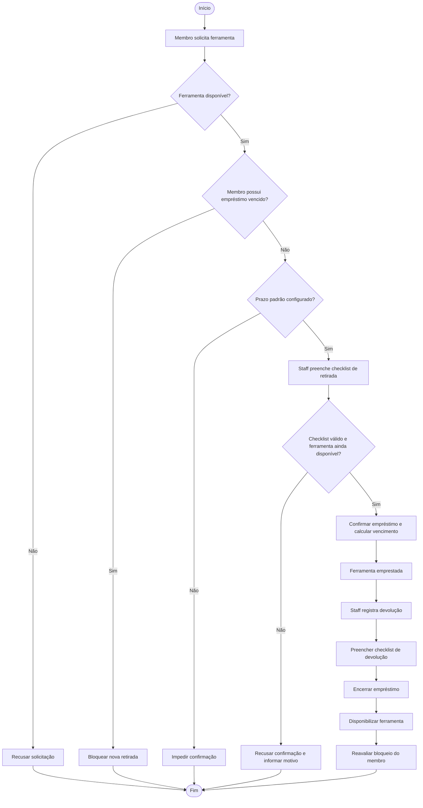
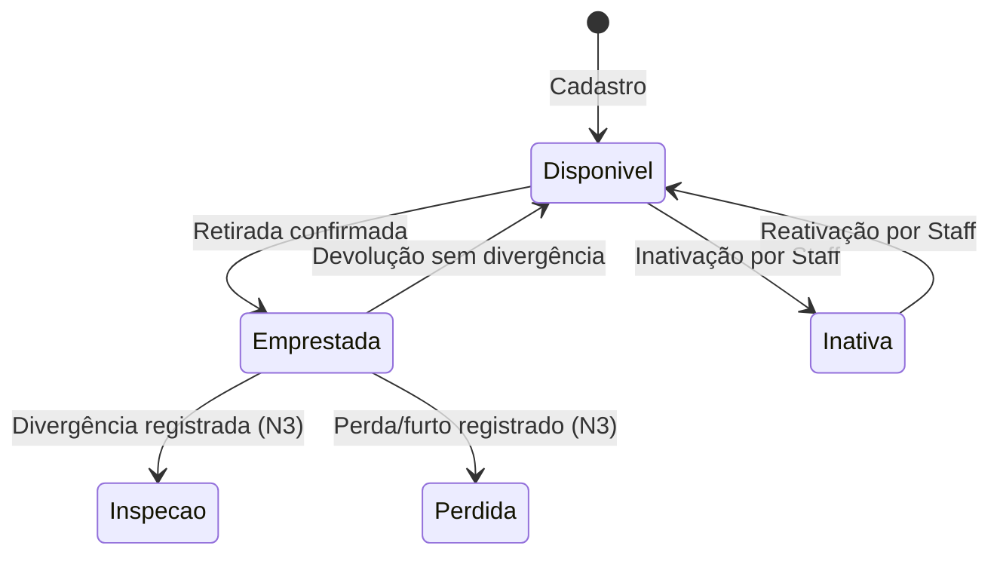

# Monitoolring — Engenharia de Requisitos

**Documentação técnica e funcional | Entrega N2 | Engenharia de Software**

> Especificação, modelagem e rastreabilidade dos requisitos de um sistema de gerenciamento de empréstimos de ferramentas para oficinas compartilhadas (*makerspaces*).

---

## Visão geral

O **Monitoolring** é um sistema desenvolvido para organizar o empréstimo, a devolução e o controle de disponibilidade de ferramentas em ambientes compartilhados.

O projeto busca solucionar problemas como a falta de rastreabilidade das retiradas, devoluções fora do prazo, divergências no estado de conservação das ferramentas e ausência de controle sobre membros com empréstimos pendentes.

A Engenharia de Requisitos estabelece o comportamento esperado do sistema, suas regras de negócio, os atores envolvidos e os critérios necessários para validar as funcionalidades.

## Escopo da documentação

| Indicador | Quantidade |
|:---|:---:|
| Requisitos funcionais identificados | **19** |
| Requisitos funcionais previstos para N2 | **15** |
| Requisitos funcionais reservados para N3 | **4** |
| Artefatos de Engenharia de Requisitos | **10** |
| Perfis de usuário | **2** |

**Perfis do sistema:** Membro (`MEMBER`) e Responsável pela oficina (`STAFF`).

A divisão de requisitos segue o README principal do projeto. O escopo previsto não deve ser interpretado como comprovação de implementação concluída.

---

## Fluxo geral de empréstimo



**Regras centrais:** uma ferramenta indisponível não pode ser emprestada; membros com empréstimos vencidos não podem realizar novas retiradas; checklists são obrigatórios nas operações de retirada e devolução.

O tratamento formal de divergências no checklist e o registro de perda ou furto são extensões previstas para a N3.

## Ciclo de vida da ferramenta



*Diagrama simplificado. As regras completas de transição estão documentadas no diagrama UML de estados.*

---

## Diagramas UML

### Diagrama de Casos de Uso

Apresenta as funcionalidades do sistema e sua associação aos atores Membro e Staff.


### Diagrama de Atividades — Retirada

Detalha as verificações de disponibilidade, inadimplência, checklist e confirmação do empréstimo.


### Diagrama de Atividades — Devolução

Representa o registro da devolução, a conferência da ferramenta e a atualização de disponibilidade.


### Diagrama de Estados

Representa os estados possíveis de uma ferramenta e os eventos que provocam suas transições.


### Diagrama de Classes de Domínio

Apresenta as principais entidades de negócio, seus atributos e relacionamentos.


O diagrama de classes representa o modelo conceitual, não necessariamente a estrutura física implementada no banco de dados.

---

## Catálogo de artefatos

### Documentação

| Artefato | Descrição |
|---|---|
| [Documento de Visão e Escopo](documentos/Documento%20de%20Vis%C3%A3o%20e%20Escopo.docx) | Contexto, objetivos, atores, limites e escopo N2/N3 |
| [Especificação de Requisitos de Software](documentos/Especifica%C3%A7%C3%A3o%20de%20Requisitos%20de%20Software%20%28ERS%29.docx) | Requisitos funcionais, não funcionais e regras de negócio |
| [Especificação Detalhada dos Casos de Uso](documentos/Especifica%C3%A7%C3%A3o%20Detalhada%20dos%20Casos%20de%20Uso.docx) | Fluxos principais, alternativos, exceções e critérios de aceite |
| [Plano de Continuidade](documentos/Plano%20de%20continuidade.docx) | Funcionalidades, dependências e evoluções previstas para N3 |

### Rastreabilidade

| Artefato | Descrição |
|---|---|
| [Matriz de Rastreabilidade](rastreabilidade/Matriz%20de%20Rastreabilidade.xlsx) | Relacionamento entre requisitos, casos de uso, regras de negócio e critérios de aceite |

### Diagramas

Os cinco diagramas UML estão disponíveis na seção anterior e no diretório [`diagramas/`](diagramas/).

---

## Requisitos funcionais por entrega

| Entrega | Requisitos | Descrição |
|---|---|---|
| N2 | FR-1 a FR-5 | Autenticação, perfis e gerenciamento de ferramentas |
| N2 | FR-8 a FR-11 | Prazo padrão, solicitação, checklist e confirmação de retirada |
| N2 | FR-12 a FR-14 | Bloqueio por atraso, devolução e checklist comparativo |
| N2 | FR-16 a FR-18 | Disponibilidade após devolução, identificação de atraso e desbloqueio |
| N3 | FR-6 e FR-7 | Histórico de empréstimos para Staff e Membro |
| N3 | FR-15 | Registro de divergências de conservação |
| N3 | FR-19 | Registro de perda ou furto |

Além dos quatro requisitos funcionais reservados para N3, existem evoluções previstas para treinamento prévio, multas automatizadas, revogação de tokens JWT, testes de desempenho e revisão de privacidade/LGPD.

## Organização do diretório

```text
Requisitos N2/
├── README.md
├── documentos/
│   ├── Documento de Visão e Escopo.docx
│   ├── Especificação de Requisitos de Software (ERS).docx
│   ├── Especificação Detalhada dos Casos de Uso.docx
│   └── Plano de continuidade.docx
├── diagramas/
│   ├── Diagrama de Casos de Uso.png
│   ├── Diagrama de Atividades - Retirada.png
│   ├── Diagrama de Atividades - Devolução de Ferramenta.png
│   ├── Diagrama de Estados.png
│   └── Diagrama de Classes - domínio.png
└── rastreabilidade/
    └── Matriz de Rastreabilidade.xlsx
```

## Referências e manutenção

A documentação foi elaborada com base nas seguintes fontes do projeto:

- [README principal](../../../README.md) — escopo atualizado e andamento da N2.
- [PRD](../prd.md) — requisitos originais e regras de negócio.
- [Convenções HTTP](../api-convencoes-http.md) — contratos e padrões da API.
- [Guia de testes manuais](../testing-manual.md) — orientações de validação.

**Status:** artefatos elaborados, sujeitos à revisão e validação da equipe.

As especificações devem ser atualizadas quando houver mudanças de escopo ou de comportamento funcional.