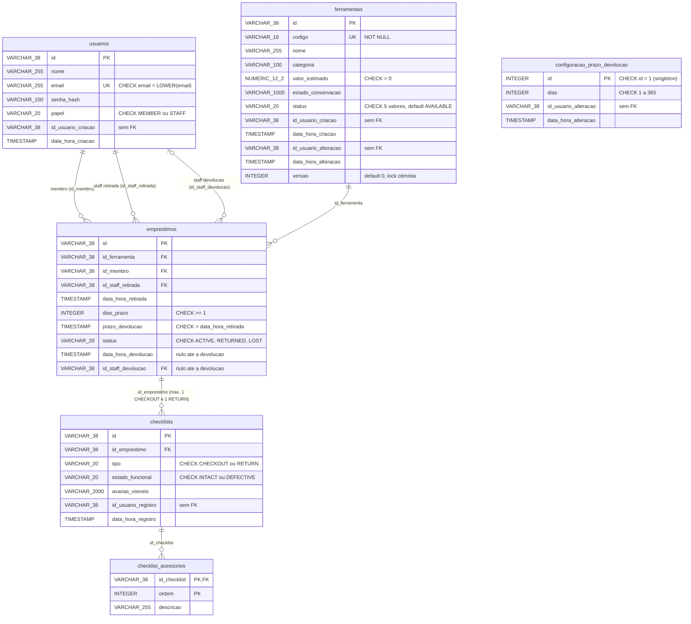

# Monitoolring — Diagrama Entidade-Relacionamento (DER)

Modelo físico do banco PostgreSQL, derivado dos changesets 1 a 7 de
[`db.changelog-master.sql`](../../backend/src/main/resources/db/changelog/db.changelog-master.sql)
(Liquibase). O schema só muda por changesets novos no fim desse arquivo; o JPA apenas valida.

## Diagrama

Linhas contínuas são **chaves estrangeiras reais** (`FOREIGN KEY` no banco). As referências
lógicas, sem FK, estão na [seção própria](#referências-lógicas-sem-fk) e não aparecem como
relacionamento no diagrama.

> `configuracao_prazo_devolucao` não se relaciona por FK com nenhuma tabela: o prazo vigente é
> **copiado** para `emprestimos.dias_prazo` na retirada.

## Relacionamentos com FK real

| Constraint | Origem → destino | Observação |
|---|---|---|
| `fk_emprestimos_ferramenta` | `emprestimos.id_ferramenta` → `ferramentas.id` | Uma ferramenta tem vários empréstimos ao longo do tempo, mas no máximo um `ACTIVE` (ver índice abaixo) |
| `fk_emprestimos_membro` | `emprestimos.id_membro` → `usuarios.id` | Tomador do empréstimo; a regra de que deve ser `MEMBER` é da aplicação (`422` para Staff), não do banco |
| `fk_emprestimos_staff_retirada` | `emprestimos.id_staff_retirada` → `usuarios.id` | Staff que confirmou a retirada |
| `fk_emprestimos_staff_devolucao` | `emprestimos.id_staff_devolucao` → `usuarios.id` | Opcional (changeset 7); nulo até a devolução |
| `fk_checklists_emprestimo` | `checklists.id_emprestimo` → `emprestimos.id` | Com `uq_checklists_emprestimo_tipo`, um empréstimo tem **no máximo um `CHECKOUT` e um `RETURN`** |
| `fk_checklist_acessorios_checklist` | `checklist_acessorios.id_checklist` → `checklists.id` | PK composta `(id_checklist, ordem)` preserva a ordem informada |

## Referências lógicas sem FK

Colunas que guardam o `id` de um usuário, mas **sem** `FOREIGN KEY`. São auditoria: o banco não
impede um id inexistente, e a integridade depende da aplicação.

| Coluna | Significado |
|---|---|
| `ferramentas.id_usuario_criacao`, `ferramentas.id_usuario_alteracao` | Quem criou e quem alterou por último a ferramenta |
| `configuracao_prazo_devolucao.id_usuario_alteracao` | Staff que alterou o prazo padrão pela última vez |
| `checklists.id_usuario_registro` | Usuário (Staff) que registrou o checklist |
| `usuarios.id_usuario_criacao` | O próprio id no autocadastro e no bootstrap; o id do Staff criador quando um Staff cadastra outro |

## Constraints e índices relevantes

| Nome | Tabela | Regra |
|---|---|---|
| `uq_ferramentas_codigo` | `ferramentas` | Código único (até 18 caracteres) |
| `uq_usuarios_email` + `ck_usuarios_email_minusculo` | `usuarios` | E-mail único e sempre gravado em minúsculas |
| `ck_usuarios_papel` | `usuarios` | `MEMBER` ou `STAFF` |
| `ck_ferramentas_status` | `ferramentas` | `AVAILABLE`, `ON_LOAN`, `UNDER_REPAIR`, `LOST`, `INACTIVE` |
| `ck_ferramentas_valor_estimado` | `ferramentas` | `valor_estimado > 0` |
| `ck_configuracao_prazo_devolucao_singleton` | `configuracao_prazo_devolucao` | `id = 1`: no máximo uma linha; sem linha = prazo ainda não configurado |
| `ck_configuracao_prazo_devolucao_dias` | `configuracao_prazo_devolucao` | `dias` entre 1 e 365 |
| `ck_emprestimos_dias_prazo` | `emprestimos` | `dias_prazo >= 1` |
| `ck_emprestimos_prazo_devolucao` | `emprestimos` | `prazo_devolucao > data_hora_retirada` |
| `ck_emprestimos_status` | `emprestimos` | `ACTIVE`, `RETURNED`, `LOST` |
| **`uq_emprestimos_ferramenta_ativo`** | `emprestimos` | **Índice único parcial** `ON emprestimos (id_ferramenta) WHERE status = 'ACTIVE'`: no máximo um empréstimo `ACTIVE` por ferramenta. É a garantia final, no banco, contra retiradas concorrentes (a aplicação também usa lock pessimista) |
| `ix_emprestimos_membro` | `emprestimos` | Índice não único em `id_membro` |
| `uq_checklists_emprestimo_tipo` | `checklists` | `UNIQUE (id_emprestimo, tipo)` |
| `ck_checklists_tipo` | `checklists` | `CHECKOUT` ou `RETURN` |
| `ck_checklists_estado_funcional` | `checklists` | `INTACT` ou `DEFECTIVE` |

## Dicionário de dados

Todos os ids são `VARCHAR(38)` gerados pela aplicação. Datas são `TIMESTAMP` sem fuso, gravadas
em UTC (o relógio da aplicação é um `Clock` UTC).

### `ferramentas` (changesets 1 e 3)

| Coluna | Descrição |
|---|---|
| `codigo` | Etiqueta física da ferramenta; única |
| `nome`, `categoria` | Identificação e agrupamento do catálogo |
| `valor_estimado` | Valor de reposição em reais, maior que zero |
| `estado_conservacao` | Texto livre sobre o estado atual |
| `status` | Ciclo de vida; `ON_LOAN` é definido pela retirada, e `UNDER_REPAIR`/`LOST` existem no enum, mas seus fluxos são da N3 |
| `versao` | Controle de concorrência otimista; o `PATCH` exige a versão atual |
| `id_usuario_*`, `data_hora_*` | Auditoria de criação e última alteração |

O changeset 3 removeu `quantidade` (cada linha é uma ferramenta individual). Linhas anteriores
foram preenchidas com valores-sentinela (`NAO_INFORMADA`, `0.01`, `Não informado (migração)`).

### `usuarios` (changeset 2)

| Coluna | Descrição |
|---|---|
| `nome`, `email` | Dados de contato; o e-mail é o login |
| `senha_hash` | Hash BCrypt; nunca exposto pela API |
| `papel` | `MEMBER` ou `STAFF` |

### `configuracao_prazo_devolucao` (changeset 4)

Tabela singleton com o prazo padrão (`dias`) e a auditoria da última alteração. Mudar o valor não
afeta empréstimos já abertos.

### `emprestimos` (changesets 5 e 7)

| Coluna | Descrição |
|---|---|
| `id_ferramenta`, `id_membro`, `id_staff_retirada` | Quem retirou o quê e quem confirmou |
| `data_hora_retirada` | Instante da retirada (UTC) |
| `dias_prazo` | Cópia do prazo padrão vigente na retirada |
| `prazo_devolucao` | `data_hora_retirada + dias_prazo × 24h` |
| `status` | `ACTIVE`, `RETURNED` ou `LOST` (`LOST` é do FR-19, N3) |
| `data_hora_devolucao`, `id_staff_devolucao` | Preenchidos na devolução; nulos antes |

### `checklists` (changesets 6)

Checklist de Conservação, **imutável**, ligado a um empréstimo. `tipo` indica o momento
(`CHECKOUT` na retirada, `RETURN` na devolução). Guarda `estado_funcional`, `avarias_visiveis`
(texto), o usuário e o horário do registro.

### `checklist_acessorios` (changeset 6)

Acessórios inclusos no checklist, um por linha, na ordem informada (`ordem`). Sem acessórios, a
API exige `["Nenhum"]` explicitamente.

## O atraso é derivado

**Não existe coluna, status ou job de atraso.** Um empréstimo está em atraso quando
`status = 'ACTIVE'` e o instante atual do `Clock` UTC é estritamente maior que `prazo_devolucao`.
O cálculo ocorre a cada consulta e a cada tentativa de retirada; por isso o bloqueio é liberado
sozinho quando a última devolução em atraso é registrada.

## Observações do modelo

- `emprestimos.status = 'LOST'` e `ferramentas.status IN ('UNDER_REPAIR','LOST')` já são aceitos
  pelos CHECKs, mas nenhum fluxo da N2 os grava.
- Não há CHECK ligando `data_hora_devolucao`/`id_staff_devolucao` ao `status`; essa coerência é da
  aplicação.
- O rollback de cada changeset está declarado no próprio arquivo e é exercitado por
  `ChangelogMigrationIT`.

Veja também: [débitos técnicos](../debitos-tecnicos/README.md) e [handoff](../handoff/README.md).
